```mermaid

flowchart LR
    subgraph TOP[" "]
        direction LR
        A["① DATA PREPROCESSING<br/><br/>• Missing value imputation<br/>• Binary target encoding<br/>• Feature scaling<br/>• Outlier detection"]
        B["② EXPLORATORY DATA ANALYSIS<br/><br/>• Failure rate by class<br/>• Signal distributions<br/>• Feature correlations"]
        C["③ IMBALANCE HANDLING<br/><br/>• ~3% positive class<br/>• SMOTETomek<br/>• Class weighting"]
        A --> B --> C
    end

    C --> D

    subgraph BOTTOM[" "]
        direction RL
        D["④ MODEL BUILDING & TUNING<br/><br/>• 9 classification algorithms<br/>• RandomizedSearchCV<br/>• GridSearchCV<br/>• Bayesian optimization"]
        E["⑤ MODEL EVALUATION<br/><br/>• Precision · Recall<br/>• F1-score · ROC-AUC<br/>• Focus on Recall & F1"]
        F["⑥ MODEL EXPLAINABILITY<br/><br/>• Tree-based feature importance<br/>• SHAP value analysis"]
        D --> E --> F
    end

    classDef prep fill:#DBEAFE,stroke:#2563EB,color:#1E3A8A,stroke-width:1.5px
    classDef eda fill:#D1FAE5,stroke:#059669,color:#065F46,stroke-width:1.5px
    classDef balance fill:#FEF3C7,stroke:#D97706,color:#92400E,stroke-width:1.5px
    classDef model fill:#EDE9FE,stroke:#7C3AED,color:#4C1D95,stroke-width:1.5px
    classDef eval fill:#CFFAFE,stroke:#0891B2,color:#164E63,stroke-width:1.5px
    classDef explain fill:#FCE7F3,stroke:#DB2777,color:#831843,stroke-width:1.5px

    class A prep
    class B eda
    class C balance
    class D model
    class E eval
    class F explain

    style TOP fill:transparent,stroke:transparent
    style BOTTOM fill:transparent,stroke:transparent

```

# 🚛 Air Pressure System Failure Prediction using Machine Learning

## 📌 Overview

This project aims to solve a problem where we can predict whether a truck is likely to experience a failure in the **Air Pressure System (APS)** — a critical component responsible for operations like **braking** and **gear shifting**. Early detection of potential APS failures enables proactive maintenance, reduces downtime, and ensures road safety.

---

## 📂 Dataset & Features

<table>
<tr>
<td width="50%" valign="top">

### 📊 Dataset

- **Source:** [UCI Machine Learning Repository](https://archive.ics.uci.edu/ml/datasets/APS+Failure+at+Scania+Trucks)
- **Rows:** ~36,000
- **Target:** `class`
  - `pos` — APS failure
  - `neg` — Non-APS failure

**📓 Experiment Notebook**

[](https://colab.research.google.com/drive/1Otojog7mKqfd6CoGvkQaV7eZ_Ej-kErV?usp=drive_link)

</td>
<td width="50%" valign="top">

### ⚙️ Features

- **170+ sensor readings and signal features**
- Captures measurements from truck components
- Feature names are anonymized for data privacy

| Feature | Description |
|---|---|
| `sensor_00` | Anonymized sensor signal |
| `sensor_01` | Anonymized sensor signal |
| `...` | Additional sensor features |
| `class` | APS failure target (`pos` / `neg`) |

</td>
</tr>
</table>

---

## ⚙️ Project Workflow



---

## 📊 Results

| Model         | ROC-AUC | Recall | F1-Score | Total_cost |
|---------------|---------|--------|----------|------------|
| XGBoost       | 0.99    | 0.99   | 0.99     |    4050    |


---

## 🛠 Tech Stack

- **Languages & Libraries:**  
  
  
  
  
  
  

- **Visualization:**  
  
  
  

- **Model Explainability:**  
  

- **API Development:**  
  

---

## 🚀 How to Run Locally

### Prerequisites

- Python version supported by the project.
- [uv](https://docs.astral.sh/uv/getting-started/installation/).
- Git.

### 1. Clone the repository

```bash
git clone https://github.com/Rahul-Shelke-1/sensor-fault-detection.git
cd sensor-fault-detection
```

### 2. Create the isolated environment

Install the project dependencies using `uv`:

```bash
uv sync --locked
```

This creates a project-specific `.venv` environment and installs the dependencies recorded in `uv.lock`, without adding them to your system Python environment.

### 3. Train and evaluate the model

Run the training pipeline to preprocess the dataset, train the selected model, evaluate its performance, and save the fitted model artifact.

```bash
uv run python train.py
```

Ensure the required dataset is available at the location configured by the training pipeline. The generated artifact must be saved to the path expected by the inference application.

### 4. Launch the Streamlit application

```bash
uv run streamlit run app.py
```

Open the local URL printed by Streamlit in your browser and provide sensor inputs to obtain a prediction.

### Notes

- Run commands from the repository root.
- Keep the training and inference preprocessing consistent.
- Do not commit `.venv/` or other local environment files.
- Follow the repository's documented artifact and dataset paths when running the pipeline.

## 🚀 Deployment Plan

The model will initially be deployed as an interactive **Streamlit web application** using Streamlit Community Cloud. This provides a simple, publicly accessible interface for demonstrating sensor fault predictions without requiring cloud infrastructure or a production-grade deployment pipeline.

### ⚙️ Current Deployment Stack

- **Streamlit** → Web interface for sensor fault predictions
- **Scikit-learn** → Load the trained model and generate predictions
- **GitHub** → Source code management and version control
- **Streamlit Community Cloud** → Host the application and provide a public URL

### ✅ Deployment Workflow

1. **Push code to GitHub** → Maintain the application code and model artifacts required for inference.
2. **Deploy to Streamlit Community Cloud** → Connect the GitHub repository and configure the application entry point (`app.py`).
3. **Load the trained model** → Load the serialized model artifact when the application runs.
4. **Generate predictions** → Users provide sensor measurements through the web interface and receive fault predictions.
5. **Share the application** → Publish the Streamlit app URL in the project README and portfolio.

### 🔮 Future Enhancements: Production-Grade MLOps

If time permits, the project can be extended into a production-oriented ML system with automated training, containerized inference, cloud infrastructure, and CI/CD.

- **Training Pipeline** → Automate data ingestion, preprocessing, model training, evaluation, and artifact generation.
- **Docker** → Containerize the training and inference environments.
- **FastAPI** → Develop a dedicated REST API for model predictions.
- **AWS S3** → Store datasets and trained model artifacts.
- **AWS ECR** → Store versioned Docker images.
- **AWS EC2** → Host the containerized prediction API.
- **GitHub Actions CI/CD** → Automate testing, image builds, and deployment.
- **MLOps Monitoring** → Introduce prediction monitoring, data and model drift detection, and model retraining workflows.

These enhancements will be implemented incrementally, based on available time and project priorities. The immediate goal is to deliver a working, publicly accessible application, with the option to evolve it into a complete end-to-end MLOps platform later.

---

## 📧 Contact

For questions or collaboration:

[rahulshelke3399@gmail.com](mailto:rahulshelke3399@gmail.com) |
[LinkedIn](https://www.linkedin.com/in/rahulshelke981) | [GitHub](https://github.com/Rahul-404)
