# 🚛 Air Pressure System Failure Prediction

**Machine learning for early detection of Air Pressure System (APS) failures in heavy-duty trucks.**

An end-to-end classification project using sensor data to identify potential APS failures, with an emphasis on imbalanced learning, failure detection, model evaluation, and explainability.

[](https://sensor-fault-detection.streamlit.app/) ·
[](https://colab.research.google.com/drive/1Otojog7mKqfd6CoGvkQaV7eZ_Ej-kErV?usp=drive_link)

---

## 🎯 Problem Statement

The Air Pressure System is a critical component in heavy-duty trucks. Detecting potential failures before they occur can help maintenance teams reduce vehicle downtime and prioritize inspections.

This project uses historical sensor measurements to classify whether a truck is likely to experience an APS failure.

**Key challenges**
- Highly imbalanced target classes, with failures representing a small proportion of observations.
- Missing values and high-dimensional sensor data.
- The trade-off between detecting failures and generating false alarms.
- The need for interpretable evaluation metrics in a failure-detection setting.

---

## 📊 Model Results

| Model         | ROC-AUC | Recall | F1-Score | Total_cost($) |
|---------------|---------|--------|----------|---------------|
| XGBoost       | 0.99    | 0.99   | 0.99     |    4050       |

**Why these metrics?**

- **Recall:** Measures the proportion of actual failures detected.
- **F1-score:** Balances precision and recall.
- **ROC-AUC:** Measures how well the model distinguishes between the two classes across classification thresholds.
- **Total cost:** Should be interpreted using the project's documented false-positive and false-negative cost function.

For industrial failure detection, recall is important, but false alarms also matter because they can lead to unnecessary inspections and maintenance.

---

## 📂 Dataset & Features

<table>
<tr>
<td width="50%" valign="top">

### 📊 Dataset

- **Source:** [UCI Machine Learning Repository](https://archive.ics.uci.edu/ml/datasets/APS+Failure+at+Scania+Trucks)
- **Rows:** ~36,000
- **Target:** `class`
  - `pos` — APS failure
  - `neg` — Non-APS failure

**📓 Experiment Notebook**

[](https://colab.research.google.com/drive/1Otojog7mKqfd6CoGvkQaV7eZ_Ej-kErV?usp=drive_link)

</td>
<td width="50%" valign="top">

### ⚙️ Features

- **170+ sensor readings and signal features**
- Captures measurements from truck components
- Feature names are anonymized for data privacy

| Feature | Description |
|---|---|
| `sensor_00` | Anonymized sensor signal |
| `sensor_01` | Anonymized sensor signal |
| `...` | Additional sensor features |
| `class` | APS failure target (`pos` / `neg`) |

</td>
</tr>
</table>

---

## ⚙️ Machine Learning Workflow

```mermaid

flowchart LR
    subgraph TOP[" "]
        direction LR
        A["① DATA PREPROCESSING<br/><br/>• Missing value imputation<br/>• Binary target encoding<br/>• Feature scaling<br/>• Outlier detection"]
        B["② EXPLORATORY DATA ANALYSIS<br/><br/>• Failure rate by class<br/>• Signal distributions<br/>• Feature correlations"]
        C["③ IMBALANCE HANDLING<br/><br/>• ~3% positive class<br/>• SMOTETomek<br/>• Class weighting"]
        A --> B --> C
    end

    C --> D

    subgraph BOTTOM[" "]
        direction RL
        D["④ MODEL BUILDING & TUNING<br/><br/>• 9 classification algorithms<br/>• RandomizedSearchCV<br/>• GridSearchCV<br/>• Bayesian optimization"]
        E["⑤ MODEL EVALUATION<br/><br/>• Precision · Recall<br/>• F1-score · ROC-AUC<br/>• Focus on Recall & F1"]
        F["⑥ MODEL EXPLAINABILITY<br/><br/>• Tree-based feature importance<br/>• SHAP value analysis"]
        D --> E --> F
    end

    classDef prep fill:#DBEAFE,stroke:#2563EB,color:#1E3A8A,stroke-width:1.5px
    classDef eda fill:#D1FAE5,stroke:#059669,color:#065F46,stroke-width:1.5px
    classDef balance fill:#FEF3C7,stroke:#D97706,color:#92400E,stroke-width:1.5px
    classDef model fill:#EDE9FE,stroke:#7C3AED,color:#4C1D95,stroke-width:1.5px
    classDef eval fill:#CFFAFE,stroke:#0891B2,color:#164E63,stroke-width:1.5px
    classDef explain fill:#FCE7F3,stroke:#DB2777,color:#831843,stroke-width:1.5px

    class A prep
    class B eda
    class C balance
    class D model
    class E eval
    class F explain

    style TOP fill:transparent,stroke:transparent
    style BOTTOM fill:transparent,stroke:transparent

```




### Methodology

1. **Preprocessing:** Handle missing values, encode the target, and apply feature transformations as required by the selected models.
2. **Exploratory analysis:** Examine class distribution, sensor signal patterns, and feature relationships.
3. **Imbalance handling:** Evaluate resampling and class-weighting strategies for the minority failure class.
4. **Model development:** Compare candidate classification algorithms and tune hyperparameters using appropriate search strategies.
5. **Evaluation:** Assess model discrimination, failure detection, precision-recall trade-offs, and operational cost.
6. **Explainability:** Use feature importance and SHAP analysis to investigate which signals influence predictions.
7. **Inference:** Load the selected trained model in the Streamlit application to produce predictions.

---

## 🛠 Tech Stack

**Programming and data processing**


**Machine learning**


**Visualization and explainability**


**Application and deployment**


---

## 🚀 Run Locally

### Prerequisites

- [Python](https://www.python.org/downloads/) — compatible with the project
- [uv](https://docs.astral.sh/uv/getting-started/installation/)
- [Git](https://git-scm.com/)

### 1. Clone the Repository

```bash
git clone https://github.com/Rahul-Shelke-1/sensor-fault-detection.git
cd sensor-fault-detection
```

### 2. Install Dependencies

```bash
uv sync --locked
```

Creates a project-specific `.venv` and installs dependencies from `uv.lock`.

### 3. Train the Model (Optional)

If the dataset is available and you want to reproduce training:

```bash
uv run python train.py
```

Ensure the dataset and model artifact paths match the project's configuration.

### 4. Launch the Application

```bash
uv run streamlit run app.py
```

Open the local URL displayed in your terminal to access the application.

### Notes

- Run commands from the repository root.
- Ensure the trained model artifact exists at the path expected by `app.py`.
- Keep training and inference preprocessing consistent.
- Do not commit `.venv/`, datasets, or generated artifacts unless explicitly required.

---

## 🚀 Deployment

The application is hosted on Streamlit Community Cloud for public access. The project also documents and demonstrates its cloud infrastructure deployment workflow, allowing the infrastructure to be provisioned for validation and torn down afterward to control costs.

### 🌐 Live Application

[](https://sensor-fault-detection.streamlit.app/)

### 🎥 Cloud Deployment Demo

Watch the recorded walkthrough of the cloud infrastructure deployment, validation, and cleanup process.

[](YOUR_DEMO_URL)

### 🏗️ Architecture


### 📚 Technical Documentation

See the [Deployment Architecture & Infrastructure Documentation](YOUR_DOCUMENTATION_URL) for the infrastructure design, Terraform modules, environment configuration, validation workflow, and resource cleanup procedure.

---

## 📧 Contact

For questions or collaboration:

[rahulshelke3399@gmail.com](mailto:rahulshelke3399@gmail.com) |
[LinkedIn](https://www.linkedin.com/in/rahulshelke981) | [GitHub](https://github.com/Rahul-404)
